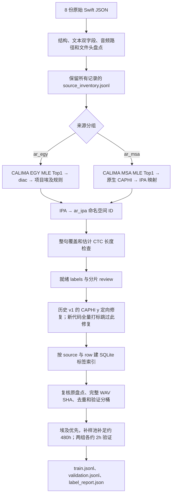

# 阿语自动音素打标与训练 Manifest 制作交接

日期：2026-11-12。分支：`codex/g2p-coverage-scan`。
本文核对的源码基线：`41a04bf3cd61156bb002117d1bc3ad1825066637`。

本文说明本轮已经使用的阿语数据制作流程，从用户提供的 Swift JSON 开始，到冻结阿语训练、验证 manifest 为止。它不是重新训练指令，也不要求重跑已经完成的全量标注。涉及工区大文件的数量和 SHA，依据用户回传报告；本地核对了对应源码、配置、词表和少量真实 CALIMA 文本输出，未独立取回全部工区标签及 WAV。

## 1. 先明确本轮究竟做了什么

本轮最终采用 **直接阿文 → CALIMA 词法分析及逐词 MLE Top1 → IPA 候选 → 固定英阿词表 ID** 的路线：

- 埃及组：使用 `calima-egy-r13`，取带元音符号的 `diac`，再由项目实现的埃及发音规则转成 IPA。
- 补样组：使用 `calima-msa-r13`，取模型原生 `caphi` 发音字段，再由项目实现的 CAPHI→IPA 映射转成 IPA。
- 两组得到的 IPA 都映射到 `en_ar_native_ipa_vocab.v1.1.json` 中的阿语 ID，逐词拼成整句 CTC 目标序列。

**这不是阿语 MFA G2P 路线。**早期讨论过 GlobalPhone 罗马化后调用 MFA，但当时没有取得经核实的阿文到该模型输入编码的完整转换依据，最终没有把手写罗马化推广到本轮训练标签。`arabic_mfa` 发音词典查词也不是本轮最终批量入口。英语部分仍保留其原有 MFA 路线，不代表阿语也走 MFA。

“打标成功”在本文中表示：文本、自动发音规则、词表 ID 和估计 CTC 长度满足代码约束。它不表示已经逐条听审，也不表示发音等于录音真实读法。此阶段没有运行最终 ASR，没有计算语料 WER，没有做音频与文本的强制对齐，没有输出词或音素时间戳。

### 1.1 全流程图



### 1.2 三种产物不要混淆

| 产物 | 解决什么问题 | 是否已确定进入训练 |
| --- | --- | --- |
| `source_inventory.jsonl` | 记录原始行、文本、路径、时长和源问题，保留追溯关系 | 否 |
| `labels.jsonl` | 所有通过自动发音与长度检查的候选标签 | 否，尚未完成最终去重和划分 |
| `train.jsonl` / `validation.jsonl` | 固定抽样、去重、划分后的训练器输入 | 是，以完成报告及 SHA 为准 |

## 2. 输入语料、路径和分组

### 2.1 工区位置

容器内仓库：

```text
/host_home/star/q00933266/qwen3-asr-hotword
```

容器外仓库：

```text
/home/star/q00933266/qwen3-asr-hotword
```

原始 JSON 公共根目录：

```text
/data/h00911716/code/ms-swift/self_test/datalist
```

下表的 JSON 路径相对于这个公共根目录；分组和读取顺序由 [源配置](../configs/en_ar_training_sources.workzone.json) 固定。

| 分组 | JSON 相对路径 |
| --- | --- |
| `ar_egy` | `ar_with_punc/egy/egy_all_without_langtag/gaoshan/train/swift-egy-gaoshan-100-0903.json` |
| `ar_egy` | `ar_with_punc/egy/egy_all_without_langtag/gaoshan/train/swift-egy-gaoshan-40h-0909.json` |
| `ar_egy` | `ar_with_punc/egy/egy_all_without_langtag/gaoshan/train/swift-egy-gaoshan-44h-0914.json` |
| `ar_egy` | `ar_with_punc/egy/egy_all_without_langtag/gaoshan/train/swift-egy-gaoshan-62h-0922.json` |
| `ar_msa` | `ar_with_punc/msa/train/swift-msa-Arabic_Broadcast_News_Speech_10h.json` |
| `ar_msa` | `ar_with_punc/msa/train/swift-msa-MGB2-1200h.json` |
| `ar_msa` | `ar_with_punc/msa/train/swift-msa-biaobei-msa-200h.json` |
| `ar_msa` | `ar_with_punc/msa/train/swift-msa-ldc-msa-800h.json` |

`ar_msa` 是本项目的**补样池分组及前端路由名称**，不是逐条音频已经鉴定为标准阿语的结论。尤其不能仅凭 MGB2 被放在这个目录，就认定其中全部语音都是纯 MSA。`ar_egy` 同样按来源路由，没有逐条自动识别方言。

### 2.2 音频目录必须实际可见

- 埃及组主要位于 `/data_91/z00841352/27A/data/ar_EGY/...`。
- 补样组主要位于 `/data/h00911716/data_ar/untar_files/...`。
- `/data_103` 与 `/data_91` 是不同路径；挂载前者不会使后者自动可见。
- 已配置的缺失路径回退是 `/home_92`→`/host_home`，主要用于英语；不会把 `/data_91` 自动改写成其他盘。

为什么先处理挂载：如果数据不可见，后续再好的发音前端也无法生成可训练样本。必须先区分“路径不可见”和“语料不存在”，避免把挂载问题当作数据质量问题。

### 2.3 原始记录格式

本轮 8 份阿语文件在盘点中均识别为 JSON 数组。读取器也支持合法 JSONL；逐行对象后带逗号、但没有外层数组的片段不等于合法 JSONL。

```json
{
  "messages": [
    {"role": "user", "content": "<audio>"},
    {"role": "assistant", "content": "language Arabic<asr_text>شكرا لكم."}
  ],
  "audios": ["/absolute/path/to/audio.wav"],
  "response": "language Arabic<asr_text>شكرا لكم.",
  "language": "Arabic"
}
```

这里的 `/absolute/path/to/audio.wav` 仅说明字段格式，不是可执行的实际音频路径。

## 3. 步骤一：盘点所有原始记录，建立来源清单

入口：[audit_en_ar_training_sources.py](../scripts/audit_en_ar_training_sources.py)。核心实现：[en_ar_source_audit.py](../src/qwen_hotword/training/en_ar_source_audit.py)。

### 3.1 执行什么

1. 流式读取 JSON 数组或 JSONL，避免将全部语料一次读入内存。
2. 每条记录保存原始 JSON 的绝对路径 `source` 和原文件内从 1 开始的 `row`。
3. 提取 `response` 中 `language Arabic<asr_text>` 后的正文。
4. 检查 `language`、文本前缀、`audios` 和最后一条 assistant 消息。
5. 解析音频真实路径，读取文件头，记录时长、采样率、帧数等元数据。
6. 将全部记录及问题写进 `source_inventory.jsonl`，汇总到 `report.json`，另保存少量 `samples.json`。

为什么保留 `source + row`：不同文件可以都有第 12941 行，单独使用行号会串样本。后续标签索引、最终 manifest 和人工复核都使用这个二元键追溯。

### 3.2 `response` 与 assistant 不一致怎么处理

`response` 正文是该流程使用的文本来源，但代码会与最后一条 assistant 正文交叉检查，不会在两份内容冲突时随意挑一份继续训练。

| 情况 | 处理 | 原因 |
| --- | --- | --- |
| 文本完全相同 | 可继续 | 两个来源字段一致 |
| 差别仅为标点或空白 | 记录 `assistant_punctuation_or_spacing_only`，允许继续 | 这类差别通常不改变当前音素序列 |
| 规范化后仍有正文差别 | 记录 `assistant_transcript_differs`，后续转 review | 没有听音证据，无法确定哪份正文对应录音 |
| 前缀缺失、语言不符、正文为空等 | 记录明确问题，后续转 review | 防止错误语言或无效文本进入打标 |

“仅标点空白”的比较键使用 NFC，将 Unicode 标点替换为空格，再合并空白。它没有把所有阿文字母、元音符号或不同单词都归成一样；也不是音频与文本一致性验证。

### 3.3 路径与文件头检查

要求一条记录只有一个绝对音频路径。优先使用原路径；原路径不存在时，才尝试已配置前缀回退，并确认回退候选实际存在。清单保留 `audio_original`、`audio_path`、`path_source`。

文件头检查要求帧数、采样率为正，计算可读时长。这一步**不完整读取 WAV 数据区**，也没有强制以“16kHz、单声道”为原始文件筛选条件。它不能检出所有损坏数据区、静音、背景噪声、错标文本或说话人问题；实际波形解码在后面的 Encoder 阶段发生。

盘点记录源 JSON 的文件大小及修改时间，并在结束时复核。后续对 `source_inventory.jsonl` 计算 SHA256。不要将此描述成“所有原始 JSON 都已经做过完整文件 SHA256”。

### 3.4 命令及本轮实际输入绑定

新任务可以先做路径探测，再做全量文件头盘点。以下命令会新建输出目录；**现有本轮盘点已经完成，不需要为了阅读本文再运行**。

```bash
cd /host_home/star/q00933266/qwen3-asr-hotword
python -B scripts/audit_en_ar_training_sources.py --check --group ar_egy
python -B scripts/audit_en_ar_training_sources.py --audit --group ar_egy --workers 12
python -B scripts/audit_en_ar_training_sources.py --audit --group ar_msa --workers 12
```

`--check` 是每个源文件的前 32 行，不是随机质量抽样。全量 `samples.json` 是每个来源的少量结构合格样例，不能当作已经完成 G2P 或听审的证明。

本轮最终使用的盘点文件：

| 分组 | 仓库下相对路径 | 文件 SHA256 |
| --- | --- | --- |
| `ar_egy` | `outputs/en_ar_training_source_audit_5bda8943/source_inventory.jsonl` | `9ad347269c258c3a31c82a724543f4a00f33b5df4600ccdc102b77466c1ddfd1` |
| `ar_msa` | `outputs/en_ar_training_source_audit_7987bde0/source_inventory.jsonl` | `5dc2a0eafdbc41bc2b6a44325a0d0133a78cc9ea31aa6b969e71738eb420baee` |

这两个目录不同，是因为埃及音频挂载补齐后做过单独重新盘点。`7987bde0` 中早先不可读的埃及记录没有被用作最终埃及输入。

**换新数据时的实现约束：**当前 `label_arabic_native.py` 的 `SOURCES` 和 `run_en_ar_training.py` 的 `AUDITS` 明确绑定上述盘点目录，不会自动选最新盘点，也没有 `--inventory` 参数。新建盘点后，需要在受版本管理的新实验配置或代码中明确更新两处绑定并审核身份；不能以为运行了新 audit 就会自动改用新数据，也不要覆盖历史目录来迁就路径。

### 3.5 本轮实际盘点规模

下列时长均为文件头统计，未去重、未留出验证集、未做自动发音筛选；文件名中的“100h”等不是实际时长依据。

| 来源文件简写 | 源记录 | 可读时长 h | 结构合格记录 | 结构合格时长 h |
| --- | ---: | ---: | ---: | ---: |
| EGY 100-0903 | 33,477 | 120.978161 | 32,157 | 115.116147 |
| EGY 40h-0909 | 12,186 | 39.128696 | 11,804 | 37.745292 |
| EGY 44h-0914 | 13,224 | 44.509556 | 12,749 | 42.574512 |
| EGY 62h-0922 | 19,952 | 62.092633 | 19,336 | 59.666001 |
| **EGY 合计** | **78,839** | **266.709046** | **76,046** | **255.101952** |
| Arabic Broadcast News | 5,383 | 8.634479 | 5,246 | 8.399207 |
| MGB2 | 290,477 | 928.972484 | 277,539 | 868.799747 |
| biaobei MSA | 154,860 | 193.071466 | 151,114 | 188.210587 |
| LDC MSA | 370,905 | 834.272189 | 356,590 | 786.360506 |
| **补样池合计** | **821,625** | **1,964.950618** | **790,489** | **1,851.770047** |

全部阿语源记录共 **900,464 条**。结构合格不等于已取得可靠发音，下一步仍可能因词法无分析、规则不支持等进入 review。

## 4. 步骤二：固定发音前端、运行环境和词表

入口：[label_arabic_native.py](../scripts/label_arabic_native.py) 的 `setup`。模型配置：[arabic_native_frontend.workzone.json](../configs/arabic_native_frontend.workzone.json)。

### 4.1 安装与模型资产

```bash
python -B scripts/label_arabic_native.py setup
```

在原有 Qwen Python 环境中执行，脚本创建：

```text
models/arabic_native_v1/runtime/             原生阿语前端 venv
models/arabic_native_v1/data/morphology_db/   两种 CALIMA 词法库
models/arabic_native_v1/data/disambig_mle/    两种 MLE 统计模型
models/arabic_native_v1/setup_completed.json 安装完成信息
```

固定 `camel-tools==1.6.0`。venv 使用 `--system-site-packages`，前端指定依赖安装在 venv 内，复用原环境已有包；它不是完全封闭的依赖环境。安装器只准备本流程使用的词法分析/MLE 子集，并未声称安装 CAMeL 所有功能；例如本流程没有安装 `camel-kenlm`。

显式依赖为：`docopt==0.6.2`、`editdistance==0.8.1`、`emoji==2.16.0`、`pyrsistent==0.20.0`、`muddler==0.1.3`、`cachetools==6.2.1`、`future==1.0.0`、`tabulate==0.9.0`。

| 用途 | 官方包 | 固定版本 | 解包后关键文件 |
| --- | --- | --- | --- |
| 埃及词法分析 | `morphology-db-egy-r13` | `0.2.0` | `morphology_db/calima-egy-r13/morphology.db` |
| MSA 词法分析 | `morphology-db-msa-r13` | `0.4.0` | `morphology_db/calima-msa-r13/morphology.db` |
| 埃及逐词选分析 | `disambig-mle-calima-egy-r13` | `0.1.0` | `disambig_mle/calima-egy-r13/model.json` |
| MSA 逐词选分析 | `disambig-mle-calima-msa-r13` | `0.2.5` | `disambig_mle/calima-msa-r13/model.json` |

下载 URL、压缩包 SHA256、解包后文件 SHA256/大小均固定在配置中，来自 CAMeL 官方 `camel-tools-data` 的 `2022.03.21` 发布路径。这里陈述的是本轮固定资产，不是宣称它们是所有时间点的最新版。配置记录各包许可为 GPL v2，模型目录保留对应 `LICENSE`。

为什么固定这些身份：不同词法库、MLE 模型或转换规则会改变训练标签。仅记录“用了 CAMeL”不足以复现。

工区存在证书链问题，因此安装器按配置对该下载请求关闭证书验证，并为 pip 指定可信下载主机；固定模型压缩包和成员文件 SHA 检查保留。这个例外只作用于安装/下载过程，不修改全局 Git、pip 或 Python SSL 设置。

### 4.2 固定 167 类英阿词表

词表：[en_ar_native_ipa_vocab.v1.1.json](../configs/phonemes/en_ar_native_ipa_vocab.v1.1.json)。

```text
SHA256: b337255bf239fdec3b4bdb0770bf39941fee74246336774c7ece8741d4534bf2
```

| ID 范围 | 类别 | 用法 |
| --- | --- | --- |
| 0 | blank | CTC 对齐空白，不写入真实目标序列 |
| 1 | unknown | 保留特殊类；遇到阿语未知音素时不靠它糊过去 |
| 2–71 | 英语 70 类 | 保持原英语前缀 ID 不变 |
| 72–166 | 阿语 95 类 | 使用 `ar_ipa:` 命名空间 |

例如 IPA `j` 对应阿语标签 `ar_ipa:j`，ID 为 91；`jː` 对应 ID 92。两者是不同类别，后者表示长辅音。`ar_ipa:ɡ` 为 147、`ar_ipa:ʔ` 为 159。

即使英语和阿语都使用同一个 IPA 字形，它们在这版表中也可以属于不同 ID；本轮没有把所有同形 IPA 跨语言强行合并。这样保留既有英语标签兼容性，同时显式区分两套前端的单位定义。训练器读取的是整数 ID，不能临时换表或重排 ID。

## 5. 步骤三：统一文本输入、选择词法分析

核心实现：[arabic_native.py](../src/qwen_hotword/phonemes/arabic_native.py)。

### 5.1 哪些行进入发音处理

保留盘点中没有结构问题、或只有 `assistant_punctuation_or_spacing_only` 的行。其他源问题直接记为 `source_structure_or_transcript_conflict`，不猜测修复正文。要求有有效的盘点时长。

前端先检查数字、特殊符号和控制字符。数字、`& @ # % *`、其他 Unicode 符号或非空白控制字符需要 review，不在这里自动做数字读法展开。原因是数字、缩写和符号可能有多种读法，静默删除会让目标与录音不一致。

分词复用项目的 Unicode 单词提取逻辑：NFC、casefold、规范引号和横线、合并空白，按字母/组合标记构建词；标点分隔词，合法内部连接符的处理继承公共逻辑。随后要求阿语词中的字符为阿文字符。混合拉丁字母、空文本等转 review。

本步骤没有给所有阿文字母做无差别折叠，没有把所有 hamza 形式都改成一个字母，也没有统一删除所有元音符号。`words` 用于分析，输出中的 `text` 仍保留原 `response` 正文，便于追溯。

### 5.2 CALIMA 实际如何选 Top1

每个来源组各加载自己的固定词法库和 MLE 模型：

```text
MorphologyDB(固定 morphology.db)
  → Analyzer(database, backoff="NONE")
  → MLEDisambiguator(analyzer, 固定 model.json, top=1)
```

MLE 优先使用逐词统计模型；必要时按分析概率选择词法分析。它是**逐词、非上下文**的 MLE 消歧，尽管接口接受整句词列表，也不等于神经上下文标音器。[官方 MLE 文档](https://camel-tools.readthedocs.io/en/latest/api/disambig/mle.html)明确说明了逐词行为。

代码要求每个词有分析，且分析内部 `source` 属于 `lex` 或 `spvar`。无分析记 `no_analysis`，其他非词汇分析记 `nonlexical_analysis`。这里分析内部的 `source` 是分析类型；输出记录顶层 `source` 是原始 JSON 路径，二者含义不同。

为什么禁用猜测回退：目前希望知道哪些标签来自词法资源和明确规则，哪些词尚未覆盖，而不是给任何字符串都生成看似完整的标签。代价是外来专名、非标准拼写及部分口语形式更容易被拒收；拒收不等于音频坏了。

## 6. 步骤四：埃及组 diac 转 IPA

埃及分支读取 Top1 分析的 `diac`，交给项目的 `egyptian_units()`。**这是项目实现的宽式、逐词发音候选规则，不是从官方模型中直接取得了一套已经听审的埃及 IPA。**

| 处理对象 | 当前实现 | 为什么处理、边界在哪里 |
| --- | --- | --- |
| 普通辅音及 hamza | 显式阿文字母→IPA 对照 | 保留辅音对立，不以字母 ID 代替音素 ID |
| `ج`、`ق` | 采用开罗实验默认 `ɡ`、`ʔ` | 为埃及来源提供方言默认；没有逐词例外词典，也不能覆盖所有埃及口音 |
| fatha / kasra / damma | `a / i / u` | 阿文常省略短元音，使用所选 `diac` 提供候选元音 |
| tanwin | 相应元音后加 `n` | 显式处理输出中的鼻尾标记；不保证录音实际读出全部书面尾音 |
| shadda | 对应辅音长音类别，如 `nː` | 保留长短辅音差异 |
| sukun | 不凭空增加元音 | 保留无元音辅音连接 |
| alif、alif maqṣūra、madda、wasla | 按字母位置及相邻标记处理长元音/词首声门音 | 这是代码中的逐词规则，未做跨词连读建模 |
| 无附加标记的 `و / ي` | 在前一输出为相应短元音时延长为 `uː / iː` | 区分元音长度与滑音 |
| `ة` | 携带元音标记时输出 `t`，否则不单独输出辅音 | 简化词内实现；不包含完整句法、停顿和连读状态判定 |
| 定冠词 lam | 满足 alif/wasla、太阳字母及 shadda 条件时省略该 lam | 显式建模这条局部同化规则 |
| dagger alif / tatweel | 前者处理长 `aː`，后者忽略 | 区分发音标记与纯字形延展 |
| 未支持字母/附标、冲突元音 | 整句转 review | 不通过删音素或改成 unknown 掩盖问题 |

没有实现完整重音、跨词变音、每个外来词发音、词汇性 qaf 例外或音频条件化的变体选择。尤其应把 `ج→ɡ、ق→ʔ` 理解为当前实验规则，而不是“所有出现这两个字母的录音都必然如此”。

本地用固定真实 CALIMA 文件、当前转换代码得到的示例：

```text
输入：لأن دي مش حاجة سهلة يعني.
words：لأن | دي | مش | حاجة | سهلة | يعني
diac：لِإِنّ | دِي | مِش | حاجَة | سَهْلَة | يَعْنِي
IPA：l i ʔ i nː d iː m i ʃ ħ aː ɡ a s a h l a j a ʕ n iː
IDs：[95,89,159,89,102,76,90,99,89,154,140,73,147,72,112,72,87,95,72,91,72,161,101,90]
```

此示例用于说明代码产物，没有据此宣称该句录音逐音素一致。相同未标音词可能有多种读法，而本轮只保留 Top1。

## 7. 步骤五：补样组 CAPHI 转 IPA

补样分支读取 Top1 分析的 `caphi`，使用 `caphi_units()` 转换。CALIMA 输出以 `_` 分隔 CAPHI 单位；代码逐单位查显式映射，再在单词内部折叠重复辅音。

CAPHI 是 CAMeL 的阿语语音表示体系，其字母不能不经核对直接当作 IPA。[官方 CAPHI 指南](https://camel-guidelines.readthedocs.io/en/latest/phonology/)给出了该表示的定义与实例。

| CAPHI | 本项目 IPA | 说明 |
| --- | --- | --- |
| `2 / 3 / 7` | `ʔ / ʕ / ħ` | 阿语常见喉部辅音 |
| `sh / th / dh` | `ʃ / θ / ð` | 多字符 CAPHI 单位对应一个 IPA 单位 |
| `kh / gh` | `x / ɣ` | 不拆成两个字母音 |
| `j` | `dʒ` | **CAPHI 的 j 不是 IPA 的 j** |
| `y` | `j` | 腭近音，即常见的“y”滑音；不是 IPA 圆唇元音 `y` |
| `s. / d. / t. / dh.` | `sˤ / dˤ / tˤ / ðˤ` | 保留强调辅音 |
| `aa / ii / uu` | `aː / iː / uː` | 保留长元音 |
| 支持的普通单位 | 对应普通 IPA 单位 | 显式允许，不任意透传未知字符串 |

例如 `y_y` 映射后成为 `jː`。折叠在**每个词内部**进行，不将两个相邻单词结尾/开头的相同辅音跨词合成一个长辅音。未知 CAPHI 标记记为 `unsupported_CAPHI`；没有自动删除标记后强行继续。

两个真实文本探针输出：

```text
输入：شكرا لكم.
diac：شُكْراً | لَكُم
IPA：ʃ u k r a n l a k u m
IDs：[154,122,93,109,72,101,95,72,93,122,99]

输入：بيت
diac：بَيْت
原生 CAPHI：b_a_y_t
IPA：b a j t
IDs：[74,72,91,116]
```

这些探针核对的是固定前端的文本输出；没有用该探针代替全量听审。

## 8. 步骤六：拼句、映射 ID、检查 CTC 物理可行性

### 8.1 整句标签怎么产生

按原词序依次拼接各词 IPA，得到一条平坦 `phones` 序列；每个单位加 `ar_ipa:` 前缀查固定表，产生 `ids`。不加入额外的词边界类别。

只要任一词无分析、任一规则失败、任一音素不在词表，整句进入 review。没有删掉问题词后假装句子完整，也没有以 ID 1 代替未知音素。这个策略减少静默错标，但会使含难词的长句更容易整体被拒收。

### 8.2 为什么还要检查长度

CTC 需要足够的输出时间步来安放目标，连续相同的目标 ID 之间还需要分隔：

```text
最少 CTC 时间步 = 目标 ID 数量 + 相邻相同 ID 的对数
```

例如 `[72,72,74]` 有 3 个目标、1 对相邻重复，至少需要 4 步。`jː` 是表中一个独立单位，与写两个 `j` ID 不是同一种标签。

标注阶段根据文件头时长估算 16kHz 输入采样数、特征帧数，再用 Qwen3-ASR 的长度函数估算 Encoder 时间步。本轮 Head 时间上采样因子为 2，因此检查：

```text
ctc_minimum_input_length(ids) <= 2 × 估计 Encoder 时间步
```

例如约 1 秒对应 100 个音频特征帧、13 个 Encoder 时间步，Head 提供约 26 步。过长标签记为 `estimated_CTC_length_infeasible`。

长度实现见 [experiment_a.py](../src/qwen_hotword/training/experiment_a.py) 的 `ctc_minimum_input_length`、`estimate_qwen_lengths` 和 [ctc_tap.py](../src/qwen_hotword/modeling/ctc_tap.py) 的 Qwen 长度函数。此检查仅判定基本可放置性，不是对齐质量证明；提取真实 Encoder 缓存时仍需要使用实际长度校验。

### 8.3 标注文件组织与字段

```text
outputs/arabic_native_labels_.../
  contract.json
  parts/
    ar_egy/00000/
      labels.jsonl
      review.jsonl
      completed.json
    ar_msa/00000/...
  labels.jsonl
  report.json
```

每片最多 2,000 条源记录。顶层 `labels.jsonl` 只合并就绪标签；review 保存在各分片，没有假定存在一个顶层 `review.jsonl`。

就绪标签字段：

| 字段 | 含义 |
| --- | --- |
| `group`、`source`、`row` | 来源组、原 JSON 绝对路径、原文件内 1-based 行号 |
| `text`、`audio_path`、`duration_seconds` | 原参考正文、盘点解析路径、盘点时长 |
| `words` | 实际送入分析的词列表 |
| `diacritized_words` | 每个词 Top1 分析的 `diac` |
| `phones` | 拼接后的 IPA 单位列表 |
| `ids` | 与 `phones` 对齐的固定词表 ID 列表 |
| `ctc_minimum_input_length` | 加入相邻重复分隔需要的最小步数 |
| `vocab_sha256` | 标签所用词表身份 |

review 行保留原盘点字段并加 `label_issue`，通常包含具体失败词或单位。当前报告按**第一个失败原因**归类；同一条可能还有其他尚未执行到的失败条件，所以原因计数不是多个独立检测器的命中率。

当前就绪文件没有逐词 CAPHI、全部候选分析、逐词音素边界或时间戳。需要复核时按 `source + row` 找到原记录，再用相同前端做定点重放，不要从平坦 ID 序列伪造时间。

### 8.4 运行、断点与身份保护

历史全量命令是：

```bash
python -B scripts/label_arabic_native.py label \
  --output-dir outputs/arabic_native_labels_v1
```

它只做自动标签，不读完整 WAV、不加载 Qwen、不用 GPU、不启动训练。原始全量入口按组串行，**没有 `--workers` 参数**；不能把修复脚本的并行参数直接套过来。

`contract.json` 绑定配置、词表、脚本、转换后端、源 inventory 和 CAMeL 版本；每片完成后保存标签/review SHA 和计数。同配置中断续跑可在原命令加 `--resume`，完成片校验后复用，未完成片重做。源码或输入身份变化会拒绝续跑，而不是直接混合两版标签。

输出目录有进程文件锁。暂停的进程仍可能持锁；需要在原任务正常退出后再续跑。锁文件存在不等于还有活跃进程，不要用删锁文件的方式绕过并发保护。

长任务显示命名阶段、每片完成条数和耗时；打标片内每 250 条更新计数，静默阶段保留周期活动提示。标注阶段没有 GPU 进程是正常现象。全量打标的瓶颈主要是 CPU 词法分析；盘点涉及大量文件头访问；最终 WAV SHA 去重则要完整读取文件。三者耗时原因不同，不能用其中一个的吞吐直接估算另一个。

本轮已有标签应直接复用。若明确需要用当前修复后的代码从头标注，应使用一个全新目录，例如 `outputs/arabic_native_labels_relabel_v3`，并先确认盘点绑定；不要覆盖 v1，也不要在不同后端身份下强行 resume v1。

## 9. 步骤七：历史 CAPHI-y 问题及定向修复

这是**本轮历史产物的必要恢复步骤**，不是所有新任务都必须重复的通用流程。

### 9.1 发生了什么

旧转换实现将 CAPHI `y` 错当成 IPA `y`，对应长辅音也成为 `yː`，而正确的目标应是表中已有的 `j / jː`。因此大量句子被 `phone_OOV` 拒收。它是编码映射错误，不能解释成 514,599 条录音的语音质量全部不合格。

首次全量结果：

| 分组 | 源记录 | ready | ready 小时 | review |
| --- | ---: | ---: | ---: | ---: |
| EGY | 78,839 | 42,517 | 114.372347 | 36,322 |
| 补样池 | 821,625 | 112,335 | 84.350883 | 709,290 |
| 合计 | 900,464 | 154,852 | 198.723229 | 745,612 |

### 9.2 修复方式与命令

入口：[repair_arabic_native_labels.py](../scripts/repair_arabic_native_labels.py)。读取旧产物，只重试 `ar_msa` 中以下精确原因：

```text
phone_OOV:'ar_ipa:y'    371,836 条
phone_OOV:'ar_ipa:yː'   142,763 条
```

旧 ready 标签逐字节复用；EGY 不重标；其他 review 不改变。修复后仍跑全部词表及 CTC 长度约束，没有为了恢复率跳过检查。

本轮最终使用 32 个 CPU 进程：

```bash
python -B scripts/repair_arabic_native_labels.py \
  --source-dir outputs/arabic_native_labels_v1 \
  --output-dir outputs/arabic_native_labels_caphi_y_v2 --workers 32
```

该命令为已执行历史记录，不要重复写入现有目录。中断时可在同一修复命令上加 `--resume`；并发数可以改变，算法及输入身份仍需满足契约。每个进程加载独立 CALIMA 和词缓存，最后按分片顺序合并，不按进程完成先后改变输出顺序。分片内先复用旧 ready，再追加恢复行，因此不能认为修复后的标签物理行序仍等于原始源行序。

并行用于词法分析，GPU 不参与。32 是这次实际使用值，不是所有机器都应照抄的建议；CPU 配额、可用内存和每进程词缓存决定可承受并发。该报告没有记录实际全量耗时，不能由它宣称“1 小时内完成”。

### 9.3 修复入口的适用边界

修复器校验旧输入确实来自那个错误后端。当前 `arabic_native.py` 已含正确 `y→j`：如果使用当前代码新建全量标签，**不要再把这一步当作必经步骤**；旧修复器也会拒绝不匹配的来源。不能通过修改 contract 或 SHA 绕过它。

| 身份 | SHA256 |
| --- | --- |
| 旧错误后端 | `2d0f0349436ceb4a2618bb61d105e1225a719cbc4db62481c4ba76ae516cfc0f` |
| 当前正确后端 | `686394f85bcbaa27c62f9266c6dd14e3f61d2676e7ff218ae7898c5b283d3753` |
| 本轮修复脚本 | `8417f4c6f6ae58a3d3680a7b0148ad66391cc8206999db684bbfba3cc4ff9094` |
| 旧聚合标签 | `b914438236bf849d7ae5a76656239959042f2b3f78f1fccf49d64c6b85df5057` |
| 修复后聚合标签 | `f692fa95ab4308a8a5a62b08fd466bffea37e5a6a3e3a3002abc282dffa4a2ba` |

### 9.4 修复后的实际结果

514,599 条重试中恢复 **512,551 条 / 1,222.947380h**；剩余 **2,048 条**因估计 CTC 长度不可行保留 review。

| 分组 | 源记录 | ready | ready 小时 | review |
| --- | ---: | ---: | ---: | ---: |
| EGY | 78,839 | 42,517 | 114.372347 | 36,322 |
| 补样池 | 821,625 | 624,886 | 1,307.298262 | 196,739 |
| **合计** | **900,464** | **667,403** | **1,421.670609** | **233,061** |

这些是**去重、验证划分和训练抽样前**的自动标签候选。EGY 没有恢复到原始 255.10h 结构合格量；“尽量优先埃及”不等于“本轮保留了全部原始埃及音频”。

最终首失败原因分布：

| review 原因 | EGY | 补样池 | 解释 |
| --- | ---: | ---: | --- |
| `source_structure_or_transcript_conflict` | 2,793 | 31,136 | 源结构或双文本实质冲突 |
| `non_Arabic_or_empty_text` | 1,652 | 2,010 | 混合文字或没有合格阿文词 |
| `unsupported_Arabic_letter` | 8,208 | 0 | EGY 转换不支持模型所给字母 |
| `no_analysis` | 20,399 | 159,775 | 至少一个词没有可用分析 |
| `number_symbol_or_control_requires_review` | 2,880 | 6 | 数字、符号等读法未处理 |
| `conflicting_vowels` | 374 | 0 | EGY 元音标记冲突 |
| `unsupported_CAPHI` | 0 | 1,583 | CAPHI 单位或标记未支持 |
| `estimated_CTC_length_infeasible` | 12 | 2,227 | 目标无法放入估计输出长度 |
| `nonlexical_analysis` | 4 | 2 | 所选分析不属于允许类型 |
| **合计** | **36,322** | **196,739** | 每条只记首个失败原因 |

剩余 review 没有被证明全部是坏音频；它同时反映前端覆盖不足、源字段冲突和长度约束。直接抛弃全部 review 会造成词汇、句长和来源选择偏差，后续若要扩容，应按具体原因单独修复、使用新产物并做配对审核。

## 10. 步骤八：将候选标签接回源清单，冻结训练和验证集

入口：[run_en_ar_training.py](../scripts/run_en_ar_training.py) 的 `all_native()`、`index_native_labels()` 和 `freeze()`。

### 10.1 先核验身份并建磁盘索引

读取 native `report.json`，要求 `automatic_labels_completed`、词表 SHA 正确、类别数为 167；重新校验聚合 `labels.jsonl` 和两组源 inventory SHA。

在新运行目录创建 `native_arabic_index.sqlite`，以 `(source, row_number)` 为主键保存标签必要字段。重复键报错，实际索引数量必须等于报告 ready 数量。

为什么使用 SQLite：候选标签有几十万条，使用磁盘索引逐条查回，避免把整个大标签文件作为 Python 字典常驻内存。源行号同时解决了修复后标签行序变化的问题。

索引中需要的标签 payload 为 `row/text/group/ids/words/vocab_sha256`；完整 `diacritized_words` 和 IPA 仍保留在原标签文件，最终 manifest 不重复携带这些大字段。

### 10.2 按原 inventory 顺序逐条复核

对每个源记录：

1. 确认源结构仍合格。
2. 用 `source + row` 查候选标签；缺标签的记录跳过并计数。
3. 要求标签的 `text`、`group` 与该源记录相同。
4. 用公共规范化重新提取 `words`，与保存的词列表逐项相等。
5. 要求词表 SHA 相同，阿语所有目标 ID 均为整数且落在 72–166。
6. 任何不完整标签不得继续进入最终 manifest。

这一步的目的不是再次猜发音，而是防止“标签来自另一批文本、词序变了、词表换了、source/row 错配”等数据拼接问题。

代码中仍有历史命名 `no_romanization` 和部分含 “romanization” 的报错。在 native 分支里它们表示找不到或不匹配的**原生标签**，不表示还在使用 GlobalPhone 罗马化。

### 10.3 读取完整 WAV 字节计算 SHA，去重并保护英语

对已有合格标签的候选，解析真实文件路径，完整读取 WAV 文件，计算 SHA256。这一步与前面的文件头盘点不同，会产生实际共享盘读取成本。

`seen` 初始包含本轮已经冻结的英语 train 和 validation 音频 SHA；新阿语记录如果与这些文件字节一致，或者与先前已经接收的阿语记录一致，就不再接收。

为什么这样做：不同文件名、不同路径也可能保存同一份音频。字节去重可以避免这类重复同时进入 train/validation，或重复累计训练小时数。

**当前去重能力的准确边界：**

- 比较的是完整文件字节；重封装、不同 WAV 头、转码或不同裁剪的同一声音，可能 SHA 不同。
- 当前实现是**先遇到并接收的合格记录保留，后续同 SHA 记录跳过**。它没有先对全语料做“相同 SHA、不同文本”的完整冲突分组，也不会回滚第一条已接收记录。
- `seen` 只加入已接收的记录；因配额等原因未接收的记录不会占用这个集合。
- 因而不能把它写成“所有重复标签冲突都已隔离”，也不能把它称为感知音频去重。

这里不会删除原始 WAV，只改变新 manifest 是否收录该记录。阿语 freeze 当前没有并行 SHA 参数；不要把 review 修复的 `--workers` 当作它的加速开关。

### 10.4 按音频 SHA 固定 train/validation 分桶

划分规则为：

```python
heldout = int(audio_sha256[:12], 16) % 100 < 3
```

即候选按 SHA 确定性分到约 3% 的验证桶，其余为训练桶，再按下面的时长目标收录。不是先将 480h 全部选完，再任意抽其中一部分作验证。

| 目标 | 时长 |
| --- | ---: |
| 阿语 train | 约 480h |
| `ar_egy` validation | 约 2h |
| `ar_msa` validation | 约 2h |

验证配额达到后，多出的 heldout 记录跳过，**不会倒回训练桶**。这样同一个文件的桶归属不随配额变化而改变。按整条音频收录，最后一条可使时长略超目标，不为凑整数小时裁剪波形。

这个划分保证的是按字节身份的文件隔离，**没有保证说话人、节目、视频或原录音会话隔离**。同一段原视频的不同切片可能进入不同 split。该路线也没有单独生成 test manifest，不能声称完成了独立 test 隔离。

### 10.5 埃及优先、补样补足的实际含义

源遍历顺序是先 `ar_egy`，后 `ar_msa`，各组内部沿 inventory 的原文件及行序。埃及组符合 train 桶的可用样本先加入，再由补样组继续补足阿语 train 480h。

这不是四份补样语料等比例分层随机抽样。补样池按 Arabic Broadcast News→MGB2→biaobei→LDC 的配置顺序遍历，达到训练时长后不再增加该训练桶样本；因此实际训练不一定用到四个来源。最终来源分布应从 manifest 和 `label_report.json` 实际统计，不能从“全量标签做过四个源”推断训练比例。

EGY 候选总量约 114.37h，还需扣去验证和重复，因而在 480h 阿语训练中的占比上限约 23.8%，实际略低。这一版是“埃及优先、补样占较大部分”的混合数据，不是 480h 纯埃及口语。

### 10.6 最后复核音频头和 CTC 长度

候选分桶且配额未满后，再读当前音频元数据，核对时长未相对盘点改变，再次检查 `minimum <= 2 × Encoder_frames`。路径缺失、标签身份冲突等会报错，不应该静默改成另一条路径或另一份标签。

只在全部 train/validation 时长目标达到后，`label_report.json` 状态才为 `labels_complete`。容量不足则为 `insufficient_labeled_hours`，在提 Encoder 前停止。报告包含每组条数、小时、拒收计数和两个 manifest SHA。

### 10.7 历史运行命令及重要执行边界

本轮已经使用的命令：

```bash
python -B scripts/run_en_ar_training.py all-native --gpu 4 \
  --arabic-native-labels outputs/arabic_native_labels_caphi_y_v2 \
  --english-cache outputs/en_ar_english_encoder_20261110_173957 \
  --output-dir outputs/en_ar_native_ctc_v1
```

**该命令不止生成 manifest。**它会在 `labels_complete` 后自动继续提取阿语 Encoder 缓存，再结合英语缓存训练英阿 CTC Head。这里记录命令是为了追溯本轮实际流程，不是在要求同事现在重新运行。

当前 CLI 没有暴露 freeze-only 子命令。若同事新任务只需要制作 manifest，应另行交付一个受版本管理的仅冻结入口，复用现有 `freeze()` 及身份检查；不能把 `all-native` 当作“只准备数据”，也不要靠随意打断任务来代替正式完成状态。本交接本身没有修改这些入口。

`all-native` 本身也不接受 `--resume`；该脚本的这个参数仅用于 `cache-en`。不要把标签分片可续跑，推断成整条 `all-native` 编排可直接原目录重启。已有 manifest 应以现有完成报告核验后复用，若需恢复后续缓存/训练，应使用其对应阶段的受支持入口。

## 11. 最终 manifest 的格式与位置

### 11.1 已有产物

```text
/host_home/star/q00933266/qwen3-asr-hotword/outputs/en_ar_native_ctc_v1/
  train.jsonl
  validation.jsonl
  label_report.json
  native_arabic_index.sqlite
```

这个目录根部的两个 manifest 对应阿语。英语沿用单独的冻结数据，训练阶段再组合缓存；不要把阿语 manifest 条数与英阿总缓存条数直接相等。

后来的 r15 merged Encoder 实验复用了同一组冻结清单，重新提取英、阿两种 Encoder 特征；更换 Encoder 不需要重新生成本文的文本标签，但旧 Encoder 隐状态不能直接代用。

### 11.2 每行字段

| 字段 | 类型/含义 |
| --- | --- |
| `id` | `en-ar-v1-` 加完整音频文件 SHA256 |
| `audio_path` | 当前解析后的绝对音频路径 |
| `text` | 原 `response` 提取的参考正文 |
| `language` | 阿语为 `ar` |
| `source_group` | `ar_egy` 或 `ar_msa` |
| `source` | 原 Swift JSON 的绝对路径 |
| `source_row` | 原文件内 1-based 行号，对应标签文件的 `row` |
| `duration_seconds` | 最终复核的文件头时长 |
| `audio_sha256` | 完整原 WAV 文件字节 SHA256 |
| `phoneme_token_ids` | 固定 167 类表下的整句阿语 ID 列表 |
| `label_length` | ID 列表长度 |
| `ctc_minimum_input_length` | ID 长度加相邻相同 ID 对数 |
| `ctc_time_upsampling_factor` | 本轮为 2 |
| `split` | `train` 或 `validation` |
| `experiment` | `full-ctc-v1` |

最终 manifest 不重复写 `phones` 和 `diacritized_words`。需要给同事看标签时，用 `(source, source_row)` 关联 `labels.jsonl` 中的 `(source, row)`，不要拿最终 JSONL 的物理行号当原始行号。

### 11.3 已返回的最终身份与数量口径

| 产物 | 用户报告的 SHA256 |
| --- | --- |
| 阿语 train | `37500a4a09ad0f532357b829d5b34a7b1febf47eaee9a5b53562d77f91037274` |
| 阿语 validation | `eb9c34496a1e7d7b0cf71537ac7a7fc0f0e0c39c97c72d4f9477e35c7c24b77b` |

已返回阿语验证 **1,456 条、190,095 个参考目标单位**。英阿总训练缓存为 496,959 条，英语为 323,382 条，由差值推得阿语训练为 **173,577 条**；该数在这里明确标为推算，不冒充已独立读取最终 manifest 的统计。

最终 EGY/补样 train 各自的精确条数、小时仍应在工区读取 `label_report.json` 或 manifest 确认。前面的 114.37h/1,307.30h 是候选池数字，不能当作最终训练混合比。

## 12. 同事接手时的最小核验命令

以下操作只读现有小报告、标签元数据或 manifest，不重跑语料、不读完整 WAV、不占 GPU。先在仓库根目录执行。

### 12.1 确认代码与数据身份

```bash
git branch --show-current
git rev-parse HEAD
git status --short
sha256sum configs/phonemes/en_ar_native_ipa_vocab.v1.1.json
sha256sum configs/arabic_native_frontend.workzone.json
```

期望分支 `codex/g2p-coverage-scan`。工区已有未知修改时先检查，不覆盖。需要同步本文时使用 `git pull --ff-only origin codex/g2p-coverage-scan`，并核对交付的提交 SHA。

### 12.2 查看全量标签结果

```bash
L=outputs/arabic_native_labels_caphi_y_v2
jq '{status,vocab_sha256,num_classes,by_group,labels_sha256,repair}' "$L/report.json"
sha256sum "$L/labels.jsonl"
```

这会读取聚合标签文本来计算 SHA，不会读 WAV。期望聚合 SHA 为第 9.3 节所列 `f692...`；不要仅凭目录名字认定它正确。

### 12.3 查看冻结结果

```bash
A=outputs/en_ar_native_ctc_v1
jq '{status,languages,vocab_sha256,hours,rows_by_group,rejections,train_manifest_sha256,validation_manifest_sha256,split_identity,speaker_disjoint_verified}' "$A/label_report.json"
wc -l "$A/train.jsonl" "$A/validation.jsonl"
sha256sum "$A/train.jsonl" "$A/validation.jsonl"
```

### 12.4 查看真实的一条标签及 manifest

```bash
head -n 1 "$L/labels.jsonl" | jq .
head -n 1 "$A/train.jsonl" | jq .
```

若要检查前文第 12941 行或第 3722 行，必须同时限定其原始 JSON `source`，因为行号不是全局唯一。需要完整源记录时查 inventory，需要自动 IPA 时查 labels，需要是否入选时查最终 manifest。

本轮应交付给接手同事的最小资产是：本说明、固定词表/配置、源 inventory 身份、标签 `report.json/contract.json`、最终 `label_report.json` 和两个 manifest。若同事需要继续修复 review，还必须保留对应分片 review/completed 文件及固定前端资产；不必传 Encoder 大缓存才能讨论标签问题。

## 13. 已实现检查与仍然缺少的验证

| 问题 | 当前是否解决 | 对后续使用的含义 |
| --- | --- | --- |
| JSON 能否解析、音频路径能否访问、文件头能否读取 | 已检查 | 排除基础格式/挂载问题，不保证声学质量 |
| `response` 与 assistant 正文冲突 | 已分流 review | 没有自动判断两份谁更正确 |
| 每词是否有允许的分析、IPA 是否进表 | 已检查 | 前端覆盖可追踪，不等于真实发音已认证 |
| CAPHI y 的错误映射 | 已定向修复，保持原词表 ID | 不能再把旧大批 OOV 归咎于音频 |
| CTC 目标长度是否基本可放置 | 已估计检查，后续缓存复核 | 不等于强制对齐或音素时间正确 |
| 相同文件字节跨已接收样本重复 | 已去重 | 没有感知去重和完整冲突组隔离 |
| 说话人、节目、原视频/会话跨 split | 未验证 | 不能声称说话人独立的泛化评估 |
| 全量埃及方言读法、MSA 纯度 | 未认证 | 来源分组及默认规则可能与部分录音不符 |
| 音频与文本是否逐条一致、语料 WER | 未做 | 当前没有一个可直接引用的阿语原语料 WER |
| 人工母语发音复核 | 未完成 | 自动标签的置信边界必须保留 |

本轮数据可以按既定约束进入 CTC 训练，后续训练已跑通；但 CTC PER 只是模型对这些自动标签的误差，不独立证明标签正确。热词检索召回、最终 ASR WER 又是另外两种指标，不能互相替代。

如果后续只选最必要的标签质量工作，建议优先：抽取 EGY 与补样组按来源、句长、难词分层的小样本，人工核对音频/文本/自动 IPA；核对最终训练源占比；对可能跨验证的原录音来源做隔离审计。这些是下一轮改进建议，**不是本文描述为已经完成的步骤**。

## 14. 实现入口与继续开发时的约束

| 文件 | 职责 |
| --- | --- |
| [en_ar_training_sources.workzone.json](../configs/en_ar_training_sources.workzone.json) | 原始 JSON 列表、组和路径回退 |
| [audit_en_ar_training_sources.py](../scripts/audit_en_ar_training_sources.py) | sample probe / 全量文件头盘点入口 |
| [en_ar_source_audit.py](../src/qwen_hotword/training/en_ar_source_audit.py) | 格式读取、双文本比较、路径与 inventory |
| [arabic_native_frontend.workzone.json](../configs/arabic_native_frontend.workzone.json) | CALIMA 资产、版本、下载及哈希 |
| [arabic_native.py](../src/qwen_hotword/phonemes/arabic_native.py) | 逐词分析、EGY diac 规则、MSA CAPHI 映射 |
| [label_arabic_native.py](../scripts/label_arabic_native.py) | setup、全量打标、分片、review、契约和 resume |
| [repair_arabic_native_labels.py](../scripts/repair_arabic_native_labels.py) | 旧 CAPHI-y OOV 定向恢复、并行及兼容检查 |
| [en_ar_native_ipa_vocab.v1.1.json](../configs/phonemes/en_ar_native_ipa_vocab.v1.1.json) | 英阿 ID 的唯一固定定义 |
| [run_en_ar_training.py](../scripts/run_en_ar_training.py) | 标签磁盘索引、字节去重、分桶、选样及 manifest，随后缓存/训练 |
| [experiment_a.py](../src/qwen_hotword/training/experiment_a.py) | 音频元数据及最小 CTC 长度公共函数 |
| [HANDOFF.md](HANDOFF.md) 0.214–0.216 | 历史交付、恢复结果及后续训练对照节点 |

本说明没有要求修改现有标签算法。接手后若更改数字读法、EGY 发音规则、CAPHI 支持、词表、去重或来源采样策略，应使用新实验身份和新输出目录，保留旧结果；更改会改变哪些样本合格、标签内容或 split，不能复用旧 report 冒充同一数据集。仅更换 Encoder 时可以复用身份一致的文本标签及 manifest，但须重新提对应 Encoder 特征。

原始盘点和标签产物位于 ignored `outputs/`，模型位于 `models/`；它们不随 Git 源码自动出现。只 pull 仓库的同事还需要取得这些工区资产或访问相同共享路径。

## 15. 官方参考与证据范围

- [CAMeL Tools MLE API](https://camel-tools.readthedocs.io/en/latest/api/disambig/mle.html)：说明逐词 MLE、Top1 接口及缓存行为；不是本文自写 EGY 规则的正确性认证。
- [CAMeL CAPHI 指南](https://camel-guidelines.readthedocs.io/en/latest/phonology/)：CAPHI 定义、长音及发音单位解释；本项目只显式支持代码中的映射子集。
- [CAMeL 官方数据发布](https://github.com/CAMeL-Lab/camel-tools-data/releases/tag/2022.03.21)：本轮固定资源下载来源；具体压缩包/成员 SHA 以仓库配置为准。

本说明中的处理逻辑来自上述仓库源码，数量与大文件 SHA 来自用户回传工区报告；三个词/句的前端示例使用固定真实 CALIMA 文件在本地复现。没有加载本地 Qwen 模型，也没有重建已完成的全量实验。
