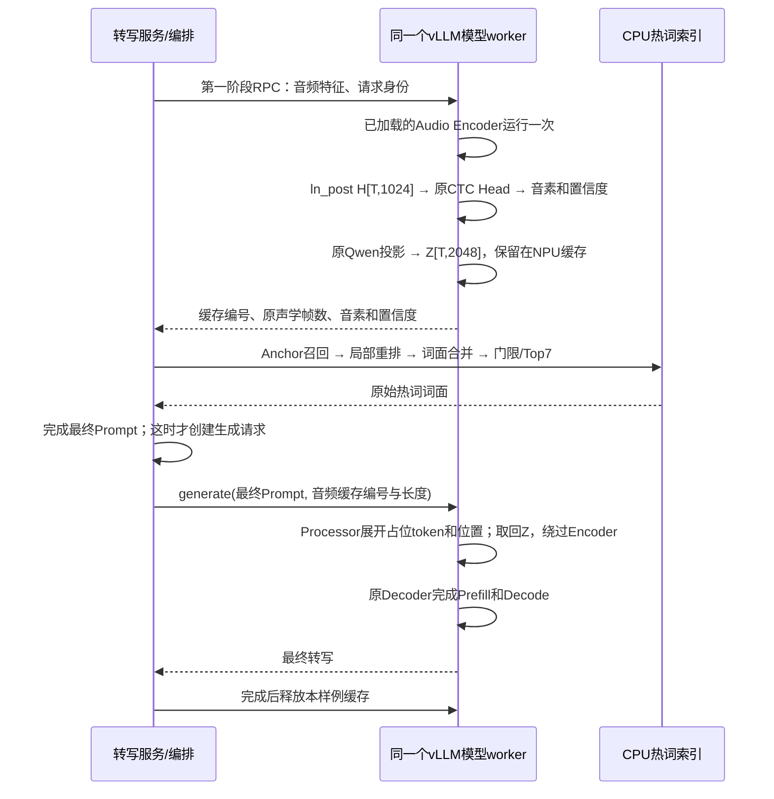

# 同一 vLLM 模型实例的两阶段音素 RAG：同事接入样例

日期：2026-10-31。目标：Qwen3-ASR-1.7B、现有 v0.3/100 类 Temporal 2x Head、Ascend
310P；接口参照 vLLM 0.23.0 + vLLM Ascend 0.23.0。

## 1. 先明确交付到哪一步

这份样例把第二种方案写成了可阅读的接入代码：**先准备音频表示和检索热词，再创建
带最终 Prompt 的生成请求，后者复用前者的音频表示。**一次对外转写可以包含这两个
内部阶段，不需要让调用方分两次上传音频。

- 本地已验证：模拟流程、缓存隔离/过期/容量/释放、长度计算、Prompt 完整性检查、
  原项目 Anchor+局部重排+跨语种发音合并；不需要模型或 NPU。
- 源码级接入样例：自定义模型/Processor、worker RPC、同 worker 缓存、原始与缓存转写
  对照。**未在本机/工区加载真实 Qwen，也未在 310P 或 H200 运行。**
- 尚未交付：生产 HTTP 服务、异步并发调度、跨 worker 缓存、图模式、流式会话缓存。
  这些不应由“单条音频冒烟通过”推断已经可用。

样例不改 vLLM 安装源码、不替换生产推理入口、不重训、不改音素表、不覆盖历史输出。
它是同事实施和定位改造点的起点，不是官方现成的 CTC/RAG 开关。

## 2. 整个调用顺序



H 是 CTC 所需的 1024 维 Encoder 特征；Z 是 Decoder 所需的 2048 维投影后表示。
CTC 的音素序列不能代替 Z。当前 Head 把时间轴扩为 2 倍，因此 CTC 有 2T 帧；
**音频占位 token 仍对应 T 行 Z，不能误用 2T。**

第一阶段是专门的 worker RPC，**不是先调用一次普通 `generate()`**。第二阶段也
不是暂停/修改旧请求；它从一开始就持有最终 Prompt，按正常路径建立自己的 Prefill、
位置和 KV 状态。这里复用的是音频表示，不是旧 Prompt 的文本 KV cache。

## 3. 文件与改造点

样例目录：`examples/vllm_two_stage_rag/`。

| 文件/接口 | 同事重点看什么 |
|---|---|
| `__init__.py:register` + `pyproject.toml` | 用通用插件在相关进程注册新架构名；保留原架构实现 |
| `model.py:rag_prepare` | 调用**已有模型**的 `_process_audio_input`，短暂读取 ln_post，运行当前 Head，缓存 Z |
| `model.py:RagWorkerExtension` | 用 `get_model()` 获取已加载模型，禁止再 `from_pretrained()` 一整套 Qwen |
| `model.py:CacheParser/CacheProcessor` | 新增明确的缓存输入字段；用原声学长度展开音频占位，保留 Qwen 原位置计算 |
| `model.py:embed_multimodal` | 有缓存编号时返回现存 Z；普通原音频与初始化 profiling 保留官方路径 |
| `retrieval.py:ProjectRetriever` | 直接调用项目 Anchor/局部重排，无 Qwen 模型加载；语言发音先合并为词面再过门限 |
| `contracts.py:AudioCache` | 缓存编号、请求归属、长度、过期、容量、释放；失效即报错，禁止悄悄重编码 |
| `run.py` | 单模型三路径对照、完整 Prompt token 校验、每路径 Encoder 次数、失败小报告 |

最终生成请求的自定义输入示意：

```python
# prepared 来自第一阶段，不含大块 H/Z；Z 留在原 NPU worker。
request = {
    "prompt_token_ids": final_prompt_ids,
    "multi_modal_data": {
        "audio": {
            "rag_audio_handle": torch.tensor([prepared["handle"]], dtype=torch.int64),
            "rag_audio_owner": torch.tensor([prepared["owner"]], dtype=torch.int64),
            "audio_feature_lengths": torch.tensor([prepared["feature_length"]], dtype=torch.int64),
        }
    },
}
result = llm.generate(request, sampling_params=sampling_params)
```

`rag_audio_handle`/`rag_audio_owner` 是**本样例新增的字段**，原版 vLLM 不认识。
必须配套注册本样例模型和 Processor，不能把这段请求直接发给未改造的生产服务。
原版 `input_audio_features` 是编码前的声学特征；将 Z 填进该字段不会实现正确旁路。

真实实现还处理了一个容易漏掉的地方：缓存编号不附带波形，不能让 Qwen 的 HF 音频
Processor 再按“音频占位符+波形”路径处理它。缓存分支先仅处理文本，再由 vLLM 的
原 Prompt 更新逻辑依据 `audio_feature_lengths` 展开音频占位符。

## 4. 快速阅读与无设备演示

在完整仓库根目录执行：

```bash
PYTHONPATH=src:examples/vllm_two_stage_rag python -B -m qwen_rag_vllm_sample.demo
```

输出应包含：`encoder_calls=1`、`generation_requests=1`、释放后缓存条目为 0，并按顺序
展示编码、检索、完成 Prompt、生成、释放。**音频表示、CTC、候选、转写全部为模拟值；
该演示不计算模型质量、不证明 NPU 兼容，也不测显存和性能。**

无完整仓库的同事可在解压包根目录运行：

```bash
PYTHONPATH=project_subset/src:examples/vllm_two_stage_rag python -B -m qwen_rag_vllm_sample.demo
```

包内 `project_subset` 是与此样例配套的项目源文件摘取，不含模型、权重、业务音频或
业务热词。包内 SHA256 清单用于核对传输完整性；生产维护仍以完整仓库版本为准。

## 5. 接入 310P 前准备什么

同事应先提供实际镜像名及 `pip show vllm vllm-ascend torch torch-npu transformers`
输出。“23.0”在此暂按 **0.23.0** 理解，不能只核对主包而忽略 Ascend 插件/公司补丁。
样例要求两者基础版本均为 0.23.0，带 `+...` 的构建后缀可通过；`rc`/`dev`/其他版本
会停下，需要同事先按其实际源码核对接口，不会自动升级或安装运行时。

在已具备匹配环境的隔离测试镜像里安装**样例插件本身**：

```bash
python -m pip install --no-deps --no-build-isolation -e examples/vllm_two_stage_rag
```

这条命令只注册样例，不安装/升级 vLLM、Ascend、Torch 或 Transformers；需要该镜像
已有 setuptools。模型加载时的 worker 子进程也必须能 import 该样例。若公司设置了
`VLLM_PLUGINS` 白名单，要把 `qwen_rag_two_stage` 加入白名单，保留已有项目。

准备以下本地文件并修改 `config.example.json` 的路径，**不要通过改 SHA 掩盖文件不配套**：

| 资产 | 本轮配套 |
|---|---|
| Qwen | 完整 Qwen3-ASR-1.7B；工区已知路径 `/glusterfs_103/models/Qwen3-ASR-1.7B` |
| Head | `outputs/mfa_v03_noise70_scratch_v1/head/ctc_head_best.pt`，SHA a6eba051…83229 |
| 音素表 | `configs/phonemes/en_es_ptbr_precision_ipa_vocab.v0.3.json`，SHA 59fbac2f…aec7f |
| 索引发音记录 | `outputs/mfa_v03_noise70_scratch_v1/indexed_pronunciations.v03.jsonl`，SHA b478451d…a98d |
| 单条音频 | 16kHz、单通道、0–30 秒内非空音频；样例不自动转采样/截断 |

完整 SHA 在示例配置中。Head 从 checkpoint 的 `head_config` 重建，按严格模式加载；
核对完整 `vocab_tokens`，保持原 FP32 Head。310P Qwen 路径先用 FP16；其与原 H200 BF16
特征的数值差别需要实测，不能仅凭维度相同就认为召回完全不变。

示例检索参数采用现有纯检索入口的基本设置并将最终 Top-k 设为 7（0.75 分数、0.35
最大编辑比例、0.5 最小后验置信度等）。**它不是已经核对所有历史评测分组的部署门限**。
正式质量对比必须拷贝对应版本的实际分组门限及候选/发音合并政策，不能用样例默认值
宣称重现了最新离线成绩。保持全部语言发音共同检索，不按已知语言删除其他语言专名。

## 6. 同事如何做第一次真实运行

选已分配的空闲逻辑 NPU，在其原有设备映射/容器设置下执行。这里不指定卡号，也不
启动或停止现有 FusionMind 服务。先让测试进程使用隔离资源，避免与生产争抢显存。

完整仓库根目录示例：

```bash
export PYTHONPATH="src:examples/vllm_two_stage_rag${PYTHONPATH:+:$PYTHONPATH}"
python -B -m qwen_rag_vllm_sample.run \
  --config examples/vllm_two_stage_rag/config.example.json \
  --audio /absolute/path/to/one_16k_mono.wav \
  --language pt \
  --output outputs/vllm_two_stage_smoke_001 \
  --execute-on-device
```

解压包运行时仅将 PYTHONPATH 的 `src` 换成 `project_subset/src`，并修改配置中的模型/
Head/索引/词表路径。样例强制离线读取，不能因本地文件缺失而自动下载 Qwen。

每次使用新输出目录，已存在则拒绝覆盖；**没有 resume、训练和批量评测**。只读三类
配套资产，初始化一次 vLLM/Qwen。为了验证改造，单条音频会走下面三个独立实验路径，
因此整次冒烟会编码三次，**每个实验路径各编码一次**：

1. `raw_baseline`：普通原音频请求，不加热词。
2. `cached_no_prompt`：先准备并缓存 Z，不加热词；与第 1 条按同样 Prompt/生成设置比较。
3. `cached_ctc_prompt`：同样的缓存路径，再加入此次 CTC 实际检索到的热词。

若前两条转写不同，停止，不跑第 3 条；先定位声学预处理/精度/表示/位置问题。
这比在所有改造同时生效后猜问题来自哪里更容易排查。文本相同只是首个必要检查，
正式接入还应比较同音频 H/Z 的误差、贪心音素输出和 Top-k，不能据单条文字相同宣称
数学上等价。

产物是 `report.json`；异常保存 `failure.json` 并保留 traceback。返回小报告、设备型号、
镜像/包版本及完整启动日志即可，不必回传模型/大张量/业务音频。

| 状态/字段 | 如何理解 |
|---|---|
| `smoke_passed` | 缓存无热词对照相同；第三条检索到词，最终 token 检查和调用次数检查通过 |
| `cache_passed_no_hotwords` | 缓存路径通过，但本条未检索出词；换一条确含已激活业务词的音频再测，不能宣称注入已验证 |
| `baseline_cache_mismatch` | 原路径与缓存无热词转写不一致，先修音频表示/预处理适配 |
| `prompt_tokens_verified` | 实际返回的完整 Prompt IDs，等于最终文本 IDs 按正确 T 展开后的序列 |
| `encoder_calls_for_route=1` | 该实验路径没有重复调用 Encoder；初始化 profiling 次数从差值中排除 |
| `cache_reads_for_route>0` | 缓存路径确实读取了本 worker 的 Z |
| `memory_saving_measured=false` | 样例没有做设备显存对比，不能拿此报告声称省了多少 |

## 7. 从冒烟到服务，同事还要补什么

**先保留单 NPU、TP/PP/DP=1、batch=1、串行、eager。**当前脚本同步顺序调用，不能
直接套到多个 HTTP 并发请求。把它包装成服务时，至少先用服务级锁串行包住
`prepare → retrieval → generate完成 → release` 整个区间，再设计可并发 runner 队列。
不能只给每个 RPC 单独加锁，也不能在任意解码执行中插入不受调度控制的 Encoder RPC。

当前临时 forward hook 只在显式、串行、eager 的准备调用里存在，并在 finally 中移除；
正式 runner 最好改为显式返回 H/Z，不能用进程全局 hook 缓存“上一条音频”。首个原型
若在公司分支的 forward context、NPU 算子或 Processor 上不兼容，应按实际错误适配，
不能用二次编码、返回 CPU 大张量或另起模型的方式冒充通过。

缓存有请求归属、随机编号、固定模型实例和长度约束；容量 32MiB、未开始使用时 60 秒
过期是**原型参数**，不是容量规划结论。当前只在操作时清理过期条目，生产需加周期
清理和入队上限。已使用条目会保留到显式 release，超时/取消必须等待生成 abort
确认后释放；不能只因为 HTTP 超时就删除正在计算的张量。

样例报告的 cache bytes 仅属于本样例；vLLM 自己的 Encoder cache/allocator 仍可能持有
引用。完整生命周期需检查原生缓存释放、排队失败、服务取消、worker 重启、重复释放
及连续请求后的 NPU 内存，不能用“字典清空”代替显存泄漏验证。缓存编号是私有内部
能力，不应直接开放给任意外部用户；服务层需绑定租户和认证，不只依赖数字 owner。

加载 Head 时用普通状态对象持有，避免其参数被误当成 Qwen checkpoint 必须包含的
权重键；Head 在初始模型加载期间分配。**额外 CTC 激活、工作区、音频缓存峰值仍未由
原生 profiling 完整证明**，需保留空间再压测。示例 0.70 内存预算仅为起步参数，并非
310P 最佳设置，也不承诺一定适合任何共卡场景。

流式版本要为每个窗口/前缀单独管理特征和 Prompt；本样例只承诺一个完整短窗口一次
编码，不涉及跨窗口增量 Encoder cache。TP/多 worker/多实例需要路由和数据面设计；
不能靠把 worker-local 缓存编号广播给另一实例解决。

## 8. 显存和性能如何验收

功能跑通后，才对比原 FusionMind+vLLM 和新单模型路径。在同一台 310P、同一精度、
相同音频、并发、上下文长度、输出上限和 **KV cache 预算**下测：

- 空载模型/服务占用、固定负载峰值、长时间稳定占用；区分进程和整卡统计。
- Encoder 次数、热词候选一致性、三语召回与最终 WER；重排和最终 ASR 分开看。
- 端到端 P50/P95、首字延迟、吞吐及取消后释放情况。

**不会因为进程统一就凭空省掉 Encoder 本身的权重和工作区。**节省的是可消除的重复
加载、独立运行时/内存池等成本，具体取决于原 Decoder 服务是否已加载音频塔。
若 vLLM 把释放空间用于更多 KV cache，整卡“已用”可能变化不大；此时应比较同预算
的最低稳定显存或同显存可承载并发。不能预先承诺省下完整 10GB 或延迟一定下降。

## 9. 依据与版本边界

以下是官方/项目源码依据；“可以尝试该改造”是工程判断，**不是官方证明这份样例已
在 310P 上有效**。

1. [vLLM Ascend 0.23.0 Qwen3-ASR-1.7B 教程](https://docs.vllm.ai/projects/ascend/en/v0.23.0/tutorials/models/Qwen3-ASR-1.7B.html)：
   有 Atlas 300I DUO 的完整模型路径与 FP16 示例；本样例从串行 eager 起步，尚未验证图模式。
2. [模型支持矩阵](https://docs.vllm.ai/projects/ascend/en/v0.23.0/user_guide/support_matrix/supported_models.html)：
   需按相应设备和模型行核对，不能把其他模型的量化/特性直接套用。
3. [Qwen3-ASR 模型实现](https://github.com/vllm-project/vllm/blob/v0.23.0/vllm/model_executor/models/qwen3_asr.py)：
   音频塔和语言模型在同一模型实现中；多模态嵌入、音频长度展开和位置计算是本次改造入口。
4. [worker 扩展与已加载模型](https://github.com/vllm-project/vllm/blob/v0.23.0/vllm/v1/worker/worker_base.py)、
   [LLM collective_rpc](https://github.com/vllm-project/vllm/blob/v0.23.0/vllm/entrypoints/llm.py)、
   [Ascend worker](https://github.com/vllm-project/vllm-ascend/blob/v0.23.0/vllm_ascend/worker/worker.py)：
   为两阶段入口提供源码依据；RPC 不是面向高吞吐大张量传输的数据面。
5. [多模态输入](https://docs.vllm.ai/en/v0.23.0/features/multimodal_inputs/)与
   [多模态解析实现](https://github.com/vllm-project/vllm/blob/v0.23.0/vllm/multimodal/parse.py)：
   `DictEmbeddingItems` 能透传模型特定字段；本样例补了 Qwen 专用缓存字段和 Processor，
   不把通用 `audio_embeds` 当作 Qwen 原生可用接口。
6. [当前 Ascend Qwen3-ASR 页面](https://docs.vllm.ai/projects/ascend/en/main/tutorials/models/Qwen3-ASR-1.7B.html)：
   声明自 Ascend v0.30.0 起该模型停止维护。这是依赖维护风险，故本次固定历史 0.23.0
   进行源码核对；不建议为此样例盲目升级到最新版本。

需要同事补充的最少信息：**实际镜像与两包版本/补丁、可用逻辑 NPU、模型/配套资产
路径、一个含已激活业务热词的短音频，以及现有 Encoder/Decoder 是否分别加载了什么。**
